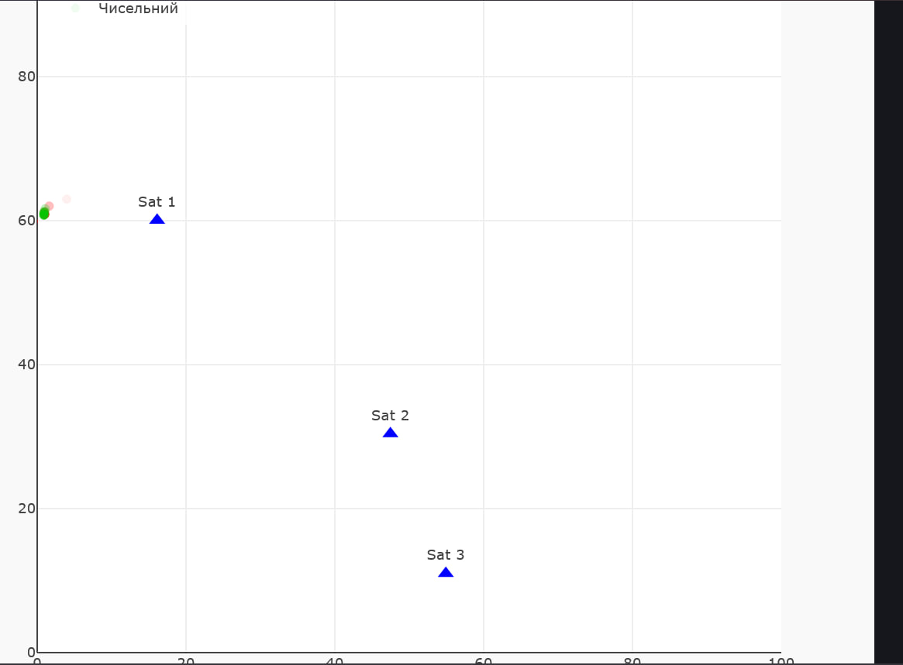

# Лабораторно-практичне заняття №3: Візуалізація вимірювань GPS

## 1. Короткий опис роботи
Метою даної лабораторної роботи є розробка веб-додатка (на базі React + Vite), який зчитує дані з емульованої вимірювальної частини GPS через WebSocket та розраховує поточне положення об'єкта на площині. 

Для визначення координат реалізовано два підходи до задачі трилатерації:
1. **Аналітичний метод:** пряме розв'язання системи рівнянь кіл.
2. **Чисельний метод:** пошук точки, що мінімізує сумарну похибку між виміряними та розрахованими відстанями (метод найменших квадратів).

**Обраний варіант реалізації чисельного методу:** *Базовий рівень (Використання готової JS-бібліотеки).* Для оптимізації та знаходження мінімуму функції втрат була інтегрована бібліотека `numeric.js` (функція `numeric.uncmin`). Як початкове наближення використовується результат аналітичного методу. 

Додатково реалізовано візуалізацію сліду руху об'єкта (поступове згасання попередніх точок розрахунку).

## 2. Інструкція із запуску додатку

**Крок 1. Запуск емулятора GPS**
Для генерації даних необхідно запустити Docker-контейнер з емулятором. Виконайте у терміналі команду:
```bash
docker run --rm --name gps-emulator -p 21701:4000 iperekrestov/university:gps-emulation-service-2026
```
**Крок 2. Запуск клієнтського додатку**
Перейдіть у директорію з React-проектом та виконайте наступні команди для встановлення залежностей та запуску сервера розробки:
```bash
npm install
npm run dev
```
Після запуску відкрийте у браузері адресу, вказану в терміналі (зазвичай http://localhost:5173).
**3. Обґрунтування порогу розкиду часу вимірювань**
Враховуючи, що кожен супутник надсилає дані незалежно, три вимірювання ніколи не надходять абсолютно одночасно. Оскільки об'єкт перебуває в русі, використання занадто "старих" даних від одного із супутників призведе до суттєвого викривлення розрахованих координат (системи кіл не перетнуться в очікуваній зоні).

У коді встановлено поріг розкиду часу (TIME_SPREAD_THRESHOLD) на рівні 500 мс (0.5 секунди). Цей інтервал є оптимальним компромісом: він дозволяє накопичити достатньо повідомлень від трьох різних супутників для розрахунку, але при цьому зміщення об'єкта за ці півсекунди залишається незначним і не виходить за межі вбудованої похибки самого GPS-емулятора (~100 метрів).

**4. Результати та порівняння методів**

(Сині трикутники — супутники, блідо-червоний слід — аналітичний метод, зелена точка — чисельний метод)

**Висновки щодо порівняння методів:**
Аналітичний метод (червоний слід): Дуже чутливий до похибок вимірювань. Оскільки емулятор додає реалістичний шум до відстаней, ідеального перетину трьох кіл не існує. Через це аналітичний розв'язок є нестабільним, і координати об'єкта помітно "стрибають" на графіку. Крім того, при розташуванні супутників майже на одній прямій метод стає вразливим до ділення на число, близьке до нуля.

Чисельний метод (зелена точка): Продемонстрував значно вищу стабільність. Використовуючи метод найменших квадратів, алгоритм ефективно згладжує похибки вимірювань. На графіку видно, що зелений маркер рухається більш плавно та передбачувано, знаходячи оптимальну точку навіть тоді, коли аналітичний метод дає значний розкид.
